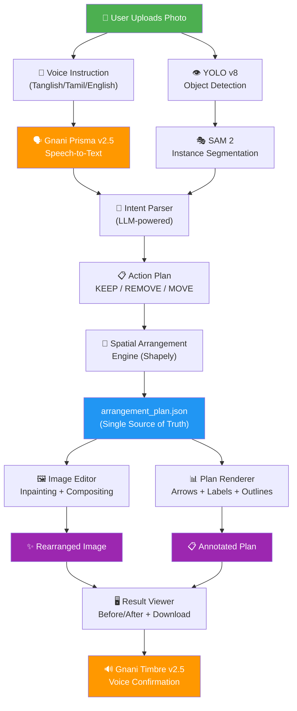
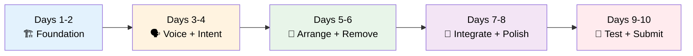

# 🏆 PLACEWISE — Prize-Winning Hackathon Strategy & Implementation Plan

> **"Apna room, apna voice, apna arrangement."**
> Upload a photo. Speak in Tanglish. Watch your space transform.

---

## 1. Why PLACEWISE Can Win

Hackathon judges evaluate on **5 axes**: Innovation, Technical Depth, Completeness, Demo Impact, and Real-World Relevance. Here's how PLACEWISE dominates each:

| Judging Criterion | What Makes PLACEWISE Stand Out |
|---|---|
| **Innovation** | No competitor combines **voice-first regional language input** + **computer vision** + **spatial planning** in one product. This isn't "another AI image generator." |
| **Technical Depth** | 6-stage modular pipeline (STT → NLU → Detection → Segmentation → Spatial Planning → Visual Synthesis) — each stage is independently testable and explainable |
| **Completeness** | End-to-end: photo in → two visual outputs out. Not a "we'll finish later" demo |
| **Demo Impact** | Live Tanglish voice command on a real room photo produces instant before/after — **judges feel the magic in 60 seconds** |
| **Real-World Relevance** | 800M+ Indians rearrange spaces without professional help. Small shops, hostels, classrooms, rental apartments — everyone is the audience |

> [!IMPORTANT]
> **The killer differentiator**: PLACEWISE is the only product where a non-English-speaking user can **speak to their room photo** and get a visual answer. This is **inclusive AI** — a theme judges love.

---

## 2. Winning Presentation Strategy

### The 60-Second Demo Script (Rehearse This)

```
[0:00] "Meet Ramesh. He runs a small shop in Chennai and wants to rearrange 
       his store but can't afford an interior designer."
[0:10] *Upload a real cluttered room photo*
[0:15] *Tap the mic, speak in Tanglish:*
       "Indha rendu chairs-um table-um remove pannunga. 
        Sofa, TV, bookshelf venum. Neat-a arrange pannunga."
[0:25] *Show real-time transcript appearing — Tanglish words highlighted*
[0:30] *Show detected objects with labels: chair_1, chair_2, sofa_1, tv_1*
[0:35] *Show the KEEP/REMOVE action table — green for keep, red for remove*
[0:40] *Reveal the arrangement plan with arrows and outlines*
[0:45] *Reveal the rearranged image — chairs gone, sofa repositioned*
[0:50] *Side-by-side before/after comparison*
[0:55] "PLACEWISE: Your space. Your language. Your arrangement."
[0:60] *Show the tech stack slide*
```

### Pitch Deck Structure (5 slides max)

1. **Problem**: 800M Indians rearrange spaces by trial-and-error. No tool speaks their language.
2. **Solution**: Photo + Voice → Visual arrangement plan + Edited image
3. **Live Demo**: The 60-second flow above
4. **Architecture**: The pipeline diagram (see Section 4)
5. **Impact & Roadmap**: Accessibility, scalability, Gnani integration depth

---

## 3. What Elevates This From "Good" to "Prize-Winning"

### 🎯 Must-Add Features Beyond the PDF

| Feature | Why It Wins Points | Implementation Effort |
|---|---|---|
| **Real-time transcript with Tanglish word highlighting** | Shows Gnani Prisma's power visually; judges see the code-mixing magic | Low — CSS animation on transcript words |
| **Confidence indicators on detections** | Shows technical maturity; not just "AI magic" but transparent AI | Low — display YOLO confidence scores |
| **Interactive object tap-to-select** | Solves ambiguity elegantly; shows UX thinking | Medium — canvas click handlers |
| **Voice feedback via Gnani Timbre** | Full voice loop: speak → see → hear confirmation. Deeply uses the sponsor's tech | Medium — TTS API call on action confirmation |
| **Arrangement animation** | Objects smoothly animate from old position to new — massive visual impact | Medium — CSS/Framer Motion transitions |
| **Accessibility mode** | High-contrast labels, large tap targets, screen-reader support | Low — Tailwind accessibility classes |
| **Multi-room gallery** | Pre-loaded demo rooms for judges to try instantly | Low — 3-4 pre-staged examples |

> [!TIP]
> **The #1 thing that separates winning hacks from good hacks: a pre-loaded demo gallery.** Judges have 2 minutes. Don't make them find a room photo. Have 4 stunning before/after examples ready to click.

---

## 4. Technical Architecture (Prize-Winning Version)



### The Critical Architectural Decision

> [!CAUTION]
> **Never let an image generation model decide the arrangement.** The `arrangement_plan.json` is the **single source of truth**. Both the edited image and the annotated plan are **renderings of the same plan**. This is what makes PLACEWISE trustworthy, not just pretty.

---

## 5. Upgraded Tech Stack

| Layer | Technology | Why This Choice |
|---|---|---|
| **Frontend** | React 18 + TypeScript + Tailwind CSS + Framer Motion | Fast dev, smooth animations, responsive |
| **Backend** | Python FastAPI + async endpoints | Non-blocking pipeline, easy ML integration |
| **Speech Recognition** | **Gnani Prisma v2.5** | Core sponsor tech — Tanglish/Tamil/English |
| **Voice Feedback** | **Gnani Timbre v2.5** | Closes the voice loop — major Gnani usage |
| **Object Detection** | YOLOv8 (Ultralytics) | Best speed/accuracy trade-off, runs locally |
| **Segmentation** | SAM 2 (Segment Anything Model 2) | Pixel-perfect masks for clean removal |
| **Intent Parsing** | Gemini Flash / GPT-4o-mini | Structured JSON output from Tanglish text |
| **Inpainting** | LaMa (Large Mask Inpainting) or Stable Diffusion Inpainting | Fast, reliable background reconstruction |
| **Spatial Geometry** | Shapely + custom rule engine | Overlap detection, boundary checks |
| **Image Ops** | OpenCV + Pillow | Compositing, blending, mask operations |
| **State Management** | Zustand (frontend) + JSON files (backend) | Simple, debuggable, no DB overhead |

---

## 6. Implementation Plan — 10 Days to Victory

### Day-by-Day Execution



---

### 📅 Days 1–2: Foundation (Get the Skeleton Working)

**Goal**: Upload a photo → see detected objects with labels on screen

#### Developer A (Backend + ML)
- [ ] Set up FastAPI project with the folder structure from the spec
- [ ] Implement `POST /api/rooms` — accept image upload, save to disk, return job ID
- [ ] Integrate YOLOv8 — detect objects, return bounding boxes + labels + confidence
- [ ] Integrate SAM 2 — generate segmentation masks from YOLO bounding boxes
- [ ] Implement `POST /api/rooms/{id}/detect` — full detection + segmentation pipeline
- [ ] Store per-object records as JSON:
  ```json
  {
    "object_id": "chair_02",
    "class": "chair",
    "confidence": 0.94,
    "bbox": [420, 280, 610, 590],
    "mask_path": "masks/chair_02.png",
    "action": null
  }
  ```

#### Developer B (Frontend)
- [ ] Scaffold React + TypeScript + Tailwind project with Vite
- [ ] Build `ImageUploader.tsx` — drag-and-drop or camera capture
- [ ] Build `ObjectCanvas.tsx` — render the uploaded image with bounding box overlays
- [ ] Display object labels with confidence badges
- [ ] Add click-to-select interaction on detected objects
- [ ] Set up API client with proper error handling
- [ ] Build basic page layout: Upload → Processing → Results

**✅ Day 2 Deliverable**: Upload any room photo → see labeled objects overlaid on the image

---

### 📅 Days 3–4: Voice & Intent (The Tanglish Magic)

**Goal**: Speak a Tanglish instruction → see correct KEEP/REMOVE actions per object

#### Developer A (Backend)
- [ ] Implement `POST /api/rooms/{id}/transcribe` — accept audio, call Gnani Prisma API
- [ ] Build the **Instruction Parser** service:
  - Accept transcript text + list of detected objects
  - Use an LLM (Gemini Flash) with structured output to produce:
    ```json
    {
      "mode": "KEEP_AND_REMOVE",
      "keep": ["sofa", "tv", "bookshelf"],
      "remove": ["chair"],
      "rearrange_remaining": true,
      "unmentioned_objects": "KEEP",
      "clarification_required": false
    }
    ```
  - Handle all 6 instruction patterns from the spec:
    - Only says what to remove → keep everything else
    - Only says what to keep → remove nothing unless explicit
    - Says both → apply both lists
    - Says "arrange everything" → keep all, rearrange
    - Ambiguous reference → ask for clarification
    - Contradictory → ask which takes priority
- [ ] Implement **fuzzy matching** between parsed object names and detected object IDs
- [ ] Implement `POST /api/rooms/{id}/instructions` — return the action plan
- [ ] Implement `PATCH /api/rooms/{id}/objects` — allow user corrections

#### Developer B (Frontend)
- [ ] Build `VoiceRecorder.tsx` — record audio, show waveform, send to backend
- [ ] Display **real-time transcript** with Tanglish words highlighted in color
- [ ] Build `ObjectEditor.tsx`:
  - Show action table: Object | Detected As | Action (KEEP/REMOVE)
  - Color-code: 🟢 KEEP, 🔴 REMOVE
  - Allow manual override: tap to toggle KEEP ↔ REMOVE
  - Allow renaming misidentified objects
- [ ] Add "Re-record" and "Edit transcript" buttons
- [ ] Build clarification dialog for ambiguous references ("Which chair? Tap to select.")

**✅ Day 4 Deliverable**: Speak "Indha chair-um table-um vendaam" → correct objects marked REMOVE

---

### 📅 Days 5–6: Arrangement & Removal (The Core Engine)

**Goal**: Generate a valid arrangement plan + remove objects from the image

#### Developer A (Backend)
- [ ] Build the **Spatial Arrangement Engine**:
  - Input: list of objects with bounding boxes, masks, and actions
  - Logic:
    1. Remove all REMOVE objects from the spatial map
    2. Identify fixed objects (wall-mounted TV, ceiling fan)
    3. For movable KEEP objects, calculate available space from removed objects
    4. Apply rule-based placement:
       - Center larger furniture in freed space
       - Maintain walkway clearance (minimum gap between objects)
       - Keep objects within room boundaries (image edges)
       - Snap to floor line (no floating furniture)
    5. Use Shapely for overlap/collision detection
  - Output: `arrangement_plan.json`
- [ ] Build the **Inpainting Pipeline**:
  - Take REMOVE objects' masks → dilate slightly → inpaint with LaMa
  - Save the "cleaned" background image
- [ ] Build the **Plan Renderer**:
  - Draw on the original image:
    - 🟢 Green solid outline → KEEP objects in original position
    - 🔴 Red semi-transparent overlay → REMOVE objects
    - ⬜ Dashed outline → proposed new position
    - ➡️ Arrow → movement direction
    - Label text → object name
- [ ] Implement `POST /api/rooms/{id}/arrange` and `POST /api/rooms/{id}/render`

#### Developer B (Frontend)
- [ ] Build `ObjectEditor.tsx` enhancements:
  - Allow marking objects as FIXED (won't move)
  - Show "Generating arrangement..." loading state with progress
- [ ] Build basic `ResultViewer.tsx`:
  - Display arrangement plan image with annotations
  - Display the cleaned/inpainted image
- [ ] Add "Regenerate" button to request alternative arrangement

**✅ Day 6 Deliverable**: A valid arrangement plan with arrows + objects visually removed from image

---

### 📅 Days 7–8: Integration & Visual Polish (Make It Prize-Worthy)

**Goal**: Complete end-to-end flow with stunning visual output

#### Developer A (Backend)
- [ ] Build the **Image Compositor** (Level 2 from spec):
  - Extract KEEP objects using segmentation masks
  - Place them at new positions from `arrangement_plan.json`
  - Inpaint the regions they vacated
  - Blend edges with feathering/Poisson blending
  - Output: the fully rearranged photograph
- [ ] Integrate **Gnani Timbre v2.5** for voice confirmation:
  - "Rendu chairs remove panna poren. Sofa-vum TV-yum same place-la irukkum."
  - Endpoint: `POST /api/rooms/{id}/speak`
- [ ] Add **arrangement scoring**: rate the layout by space utilization, symmetry, walkway access
- [ ] Optimize pipeline speed — aim for < 30 seconds total processing

#### Developer B (Frontend)
- [ ] Build the **Before/After Viewer**:
  - Slider comparison (drag to reveal before vs. after)
  - Side-by-side toggle
  - Animated transition (objects smoothly move to new positions using Framer Motion)
- [ ] Build the **Plan Viewer**:
  - Zoomable annotated plan image
  - Click an object to see its action details
- [ ] Add **Download buttons**: "Download Rearranged Image" + "Download Plan"
- [ ] Add **Gnani Timbre audio playback** — play voice confirmation
- [ ] Build the **Demo Gallery**: 4 pre-loaded room examples with pre-recorded Tanglish instructions
  - Living room (cluttered)
  - Small shop / store
  - Bedroom
  - Classroom / office
- [ ] Polish the UI:
  - Smooth page transitions
  - Loading skeletons
  - Error states with helpful messages
  - Mobile-responsive layout

**✅ Day 8 Deliverable**: Complete user journey — photo → voice → plan → rearranged image → voice feedback

---

### 📅 Days 9–10: Test, Fix, Record, Submit

**Goal**: Bulletproof demo + polished submission

- [ ] **Test Matrix** (build 20-30 test cases):

  | Test Case | Room Type | Instruction Language | Objects | Expected Result |
  |---|---|---|---|---|
  | 1 | Living room | Tanglish | 6 objects, remove 2 | Clean removal + plan |
  | 2 | Bedroom | Tamil | 4 objects, keep 2 | Correct classification |
  | 3 | Shop | English | 8 objects, rearrange all | Valid spatial plan |
  | 4 | Kitchen | Tanglish (ambiguous) | 5 objects | Clarification dialog |
  | ... | ... | ... | ... | ... |

- [ ] Fix critical bugs (prioritize: detection accuracy > inpainting quality > arrangement logic)
- [ ] **Record the demo video**:
  - 1080p screen recording + webcam picture-in-picture
  - Clear audio narration
  - Show the Tanglish voice input clearly
  - Show the before/after transformation
  - 60 seconds MAX
- [ ] **Write the README**:
  - Problem statement + solution
  - Architecture diagram
  - Screenshots of each step
  - Setup instructions (must work in `< 5 commands`)
  - Gnani integration explanation
  - Link to demo video
- [ ] **Prepare for live demo**:
  - Have 3 backup room photos ready
  - Have 3 pre-recorded Tanglish audio clips as fallback
  - Test on the presentation laptop
  - Have a screen recording as absolute backup

---

## 7. Project Structure (Final)

```
placewise/
├── frontend/
│   ├── src/
│   │   ├── components/
│   │   │   ├── ImageUploader.tsx      # Drag-drop + camera capture
│   │   │   ├── VoiceRecorder.tsx      # Mic input + waveform + transcript display
│   │   │   ├── ObjectCanvas.tsx       # Image with detection overlays
│   │   │   ├── ObjectEditor.tsx       # KEEP/REMOVE table + corrections
│   │   │   ├── ResultViewer.tsx       # Before/after slider + plan viewer
│   │   │   ├── ArrangementAnimation.tsx  # Framer Motion object transitions
│   │   │   ├── DemoGallery.tsx        # Pre-loaded examples for judges
│   │   │   └── AudioPlayer.tsx        # Timbre voice playback
│   │   ├── pages/
│   │   │   ├── HomePage.tsx           # Landing + gallery
│   │   │   └── WorkspacePage.tsx      # Main arrangement workflow
│   │   ├── hooks/
│   │   │   ├── useAudioRecorder.ts
│   │   │   └── useArrangementJob.ts
│   │   ├── api/
│   │   │   └── placewise.ts           # API client
│   │   ├── types/
│   │   │   └── index.ts              # Shared TypeScript types
│   │   └── App.tsx
│   ├── public/
│   │   └── demo/                      # Pre-loaded demo images + audio
│   ├── package.json
│   └── tailwind.config.js
│
├── backend/
│   ├── app/
│   │   ├── main.py                    # FastAPI app + CORS
│   │   ├── routes/
│   │   │   ├── rooms.py              # Room CRUD + upload
│   │   │   ├── voice.py              # Transcription + TTS
│   │   │   ├── vision.py             # Detection + segmentation
│   │   │   └── arrangement.py        # Layout + rendering
│   │   ├── services/
│   │   │   ├── gnani_stt.py          # Prisma v2.5 integration
│   │   │   ├── gnani_tts.py          # Timbre v2.5 integration
│   │   │   ├── instruction_parser.py # Tanglish → structured actions
│   │   │   ├── object_detector.py    # YOLOv8 wrapper
│   │   │   ├── segmentation.py       # SAM 2 wrapper
│   │   │   ├── layout_engine.py      # Spatial arrangement + Shapely
│   │   │   ├── inpainting.py         # LaMa / SD inpainting
│   │   │   ├── compositor.py         # Object extraction + repositioning
│   │   │   └── plan_renderer.py      # Annotation drawing (arrows, labels)
│   │   ├── schemas/
│   │   │   ├── room.py
│   │   │   ├── objects.py
│   │   │   └── arrangement.py
│   │   └── core/
│   │       └── config.py             # API keys, model paths
│   ├── models/                        # Downloaded model weights
│   ├── storage/                       # Uploaded images, masks, results
│   ├── requirements.txt
│   └── Dockerfile
│
├── demo/                              # Pre-loaded demo assets
│   ├── rooms/                         # 4 room photos
│   ├── audio/                         # Pre-recorded Tanglish instructions
│   └── results/                       # Pre-computed results for fast demo
│
├── tests/
│   ├── test_instruction_parser.py
│   ├── test_layout_engine.py
│   └── test_data/
│       ├── images/
│       └── instructions.json
│
├── docs/
│   ├── architecture.png
│   └── screenshots/
│
├── README.md
├── docker-compose.yml
└── .env.example
```

---

## 8. API Specification

| Endpoint | Method | Purpose | Request | Response |
|---|---|---|---|---|
| `/api/rooms` | POST | Upload photo | `multipart/form-data` with image | `{ room_id, image_url, status }` |
| `/api/rooms/{id}/detect` | POST | Detect objects | — | `{ objects: [{ id, class, confidence, bbox }] }` |
| `/api/rooms/{id}/transcribe` | POST | Transcribe voice | `multipart/form-data` with audio | `{ transcript, language, words[] }` |
| `/api/rooms/{id}/instructions` | POST | Parse intent | `{ transcript }` | `{ mode, keep[], remove[], actions[] }` |
| `/api/rooms/{id}/objects` | PATCH | Correct objects | `{ corrections[] }` | `{ updated_objects[] }` |
| `/api/rooms/{id}/arrange` | POST | Generate layout | `{ fixed_objects[] }` | `{ arrangement_plan }` |
| `/api/rooms/{id}/render` | POST | Generate outputs | — | `{ rearranged_image_url, plan_image_url }` |
| `/api/rooms/{id}/results` | GET | Fetch results | — | `{ images, plan_json, status }` |
| `/api/rooms/{id}/speak` | POST | Voice feedback | `{ text }` | `{ audio_url }` |

---

## 9. Key Code Patterns to Implement

### Instruction Parser (The Brain)

```python
# backend/app/services/instruction_parser.py

SYSTEM_PROMPT = """You are an instruction parser for PLACEWISE, a space arrangement app.
Given a Tanglish/Tamil/English transcript and a list of detected objects, 
output a structured JSON action plan.

Rules:
- If user only mentions objects to REMOVE → keep everything else
- If user only mentions objects to KEEP → don't remove anything unless explicit
- If ambiguous ("that one", "andha") → set clarification_required = true
- Match fuzzy names: "chair" matches "chair_1", "chair_2" etc.
- "rendu chairs" means both chairs
- "ellame" / "everything" means all objects
- "vendaam" / "remove" = REMOVE
- "venum" / "irukkattum" / "keep" = KEEP

Output format:
{
  "mode": "REMOVE_ONLY" | "KEEP_ONLY" | "KEEP_AND_REMOVE" | "REARRANGE_ALL",
  "actions": [
    {"object_id": "chair_1", "action": "REMOVE"},
    {"object_id": "sofa_1", "action": "KEEP"}
  ],
  "rearrange_remaining": true/false,
  "clarification_required": false,
  "clarification_message": null
}"""
```

### Spatial Layout Engine (The Geometry)

```python
# backend/app/services/layout_engine.py

from shapely.geometry import box, Polygon
from shapely.ops import unary_union

class LayoutEngine:
    def __init__(self, room_bounds: tuple, objects: list):
        self.room = box(0, 0, room_bounds[0], room_bounds[1])
        self.objects = objects
    
    def arrange(self) -> dict:
        keep_objects = [o for o in self.objects if o["action"] == "KEEP"]
        remove_objects = [o for o in self.objects if o["action"] == "REMOVE"]
        
        # Calculate freed space from removed objects
        freed_regions = [self._bbox_to_polygon(o["bbox"]) for o in remove_objects]
        freed_space = unary_union(freed_regions)
        
        # For each movable KEEP object, find optimal position
        plan = []
        for obj in keep_objects:
            if obj.get("fixed", False):
                plan.append({**obj, "from": obj["bbox"][:2], "to": obj["bbox"][:2]})
                continue
            
            new_pos = self._find_best_position(obj, freed_space, plan)
            plan.append({**obj, "from": obj["bbox"][:2], "to": new_pos})
        
        return {"objects": plan, "constraints": self._check_constraints(plan)}
```

---

## 10. Scoring & Evaluation Framework

Build this to **prove to judges** that PLACEWISE works:

| Metric | Target | How to Measure |
|---|---|---|
| Speech Recognition Accuracy | ≥ 85% object names correct | Test 50 Tanglish utterances |
| Intent Classification | ≥ 90% correct KEEP/REMOVE | Test against labeled instruction set |
| Object Detection | ≥ 80% mAP on furniture | Test on 20 room images |
| Segmentation Quality | ≥ 75% IoU on masks | Visual inspection + IoU calculation |
| Inpainting Quality | No visible artifacts in 70%+ cases | Human evaluation on test set |
| Arrangement Validity | 0 overlaps, 0 out-of-bounds | Automated geometric checks |
| End-to-End Latency | < 30 seconds total | Timer from upload to results |
| Demo Success Rate | 4/4 demo scenarios work perfectly | Rehearse until 100% reliable |

> [!WARNING]
> **Never claim accuracy numbers you can't back up.** Run the tests, report real numbers. Judges respect honesty + methodology far more than inflated claims.

---

## 11. Risk Mitigation for Demo Day

| Risk | Mitigation |
|---|---|
| Gnani API is down | Pre-cache transcriptions for demo images; have text input fallback |
| YOLO misses objects | Have a manual "Add Object" button; use pre-tested images for demo |
| Inpainting produces artifacts | Show Level 1 (plan with arrows) as primary; inpainted image as "preview" |
| Voice doesn't work in noisy venue | Have a "Type instruction" fallback; pre-recorded audio clips |
| Internet is slow/down | Run YOLO + SAM locally; only Gnani APIs need internet |
| Demo laptop fails | Have the demo video as backup; deploy to cloud as second backup |

---

## 12. README Template (For Submission)

```markdown
# 🏠 PLACEWISE — Your Space, Your Language, Your Arrangement

> Upload a room photo. Speak in Tanglish. Get a visual rearrangement plan.

## 🎬 Demo Video
[Watch the 60-second demo →](link)

## 🚀 Quick Start
git clone https://github.com/your-team/placewise
cd placewise
docker-compose up        # Starts frontend + backend
# Open http://localhost:3000

## 🏗️ Architecture
[Architecture diagram]

## 🗣️ Gnani Integration
- **Prisma v2.5**: Converts Tanglish/Tamil/English voice → text
- **Timbre v2.5**: Provides voice confirmations in regional language
- Gnani is the CORE input mechanism, not an add-on

## 🧪 Test Results
| Metric | Score |
|---|---|
| Speech Recognition | XX% |
| Intent Classification | XX% |
| Object Detection | XX% |
| Arrangement Validity | XX% |

## 👥 Team
- Developer A — Backend, ML Pipeline
- Developer B — Frontend, UX, Integration
```

---

## 13. Final Checklist Before Submission

- [ ] Demo works end-to-end with zero manual intervention
- [ ] 4 pre-loaded demo scenarios all work
- [ ] README has architecture diagram + screenshots + setup instructions
- [ ] Demo video is recorded, edited, and linked
- [ ] Gnani (Prisma + Timbre) integration is clearly visible and explained
- [ ] Test results are documented with real numbers
- [ ] Code is clean, commented, and on a public repository
- [ ] .env.example has all required variables documented
- [ ] Both outputs (rearranged image + annotated plan) are downloadable
- [ ] Fallback mechanisms work (text input, manual object add, pre-recorded audio)
- [ ] The team can explain every pipeline stage if asked

> [!TIP]
> **The winning formula**: Make the demo **emotionally compelling** (Tanglish voice on a real room), **technically transparent** (show the pipeline), and **honestly evaluated** (real test numbers). Judges remember the hack that made them feel something.
