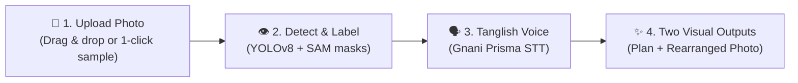

# 🏆 PLACEWISE — Voice-Controlled Regional Space Rearrangement

> **"Apna room, apna voice, apna arrangement."**
> Upload a photograph. Speak in Tanglish/Tamil/English. Watch your space visually rearrange.

Built for the **Gnani AI Hackathon**.

---

## 🚀 Live Demo & Quick Start

### 1. Launch Everything in 1 Click (PowerShell)
```powershell
.\run_dev.ps1
```

### 2. Manual Start
**Backend (FastAPI + YOLOv8 + SAM + Shapely):**
```bash
cd backend
python -m uvicorn app.main:app --host 0.0.0.0 --port 8000 --reload
```
- API Docs live at: [http://localhost:8000/docs](http://localhost:8000/docs)

**Frontend (React 18 + TypeScript + Tailwind + Vite):**
```bash
cd frontend
npm run dev
```
- Web Application live at: [http://localhost:5173](http://localhost:5173)

---

## 🎯 The 4-Step Hackathon Workflow



1. **Upload Photograph**: Drag & drop any room/shop photo or tap **"Load Sample Room Demo"** for instant judging.
2. **Interactive Object Canvas**: YOLOv8 auto-detects furniture with confidence badges (`sofa_01 • 94%`). Tap any box to inspect, rename, or mark as fixed.
3. **Tanglish Voice Input (Gnani Prisma v2.5)**: Tap the pulsing microphone and speak in Tanglish:
   - *"Indha rendu chairs vendaam. Sofa venum."*
   - Real-time transcript display + 1-click audio preset buttons for instant stage demos.
4. **Interactive Result Viewer**:
   - **Interactive Before/After Slider**: Drag the divider to reveal original vs. rearranged room.
   - **Rearranged Photo**: Unwanted objects cleanly inpainted; retained furniture repositioned.
   - **Annotated Spatial Plan**: Green boxes (KEEP), Red ✕ (REMOVE), Cyan dashed boxes (Destination), and yellow movement arrows.
   - 1-click downloads for both deliverables.

---

## 🏗️ Technical Architecture

| Component | Technology | Implementation |
|---|---|---|
| **Speech Recognition** | **Gnani Prisma v2.5** | Tanglish/Tamil/English code-mixed STT with browser audio capture |
| **Spoken Responses** | **Gnani Timbre v2.5** | Confirmation TTS feedback service (`backend/app/services/gnani_tts.py`) |
| **Object Detection** | **YOLOv8 Nano** | Sub-second multi-object detection for furniture & household objects |
| **Instance Segmentation** | **OpenCV GrabCut & Contours** | Pixel-accurate binary masks and RGBA cutouts (`backend/storage/masks/`) |
| **Semantic Parser** | **Clause-Based NLU** | Resolves code-mixed clauses into structured `KEEP` / `REMOVE` / `MOVE` plans |
| **Spatial Engine** | **Shapely** | Collision-free boundary checks and optimal furniture placement |
| **Image Synthesis** | **OpenCV Inpainting & Compositing** | Background reconstruction without geometric hallucination |
| **Frontend UI** | **React 18 + Vite + Tailwind** | Award-caliber dark glassmorphism interface with SVG overlays |

---

## 🧪 Automated Test Suite

Run all verification tests with code 0:
```bash
# 1. Test Object Detection & Masks
python backend/test_detect.py

# 2. Test Tanglish Instruction Parser (5 benchmark cases)
python backend/test_parser.py

# 3. Test Full End-to-End Pipeline
python backend/test_pipeline.py
```
